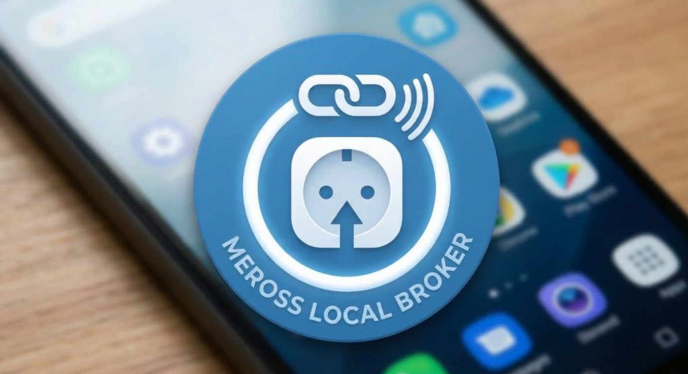

[English](README.md) · **Français**

# Meross Local Broker — add-on Home Assistant



Add-on **non officiel** qui remplace le cloud Meross par un broker local pour
Home Assistant. Il permet de contrôler les appareils Meross sur le réseau local,
sans dépendre du cloud pour l'usage quotidien.


## Les trois briques du montage

| Brique                  | Rôle                              | Dépôt                                                                           |
| ----------------------- | --------------------------------- | ------------------------------------------------------------------------------- |
| **Meross Local Broker** | add-on : broker MQTT + API locale | [mazkagaz/meross-local-broker](https://github.com/mazkagaz/meross-local-broker) |
| **Meross Local Cloud**  | intégration Home Assistant (HACS) | [mazkagaz/meross-local-cloud](https://github.com/mazkagaz/meross-local-cloud)   |
| **Meross Local Pairer** | application Android d'appairage   | [mazkagaz/meross-local-pairer](https://github.com/mazkagaz/meross-local-pairer) |

```
Appareil Meross ──MQTT/TLS──> add-on Meross Local Broker ──API/MQTT──> intégration HA
                                      ^
                                      │ appairage initial
                             Meross Local Pairer (Android)
```

## Compatibilité

Le broker fonctionne avec les appareils Meross qui acceptent un broker local.
Le **MRS100** (volet roulant) sert de référence de validation ; toutes les
autres familles du catalogue (multiprises, capteurs, garage, purificateur,
MST, compteurs, MSXH0, HP110, MTS9, thermostats…) attendent des testeurs sur
matériel réel. Ouvrez une
[issue](https://github.com/mazkagaz/meross-local-broker/issues) en précisant le
modèle, le firmware et les fonctions qui marchent ou non. Les demandes
d'intégration spécifiques sont bienvenues.

## Compatibilité des versions

| Brique                         | Version minimale | Remarques                                                    |
| ------------------------------ | ---------------- | ------------------------------------------------------------ |
| Broker                         | 1.4.8            | profil MRS100 2026.11.4 ; 3.2.2 pour la présentation number  |
| Intégration Meross Local Cloud | 3.2.2            | moteur profils 2.5.1 ; Position et durées en champ de saisie |
| Meross Local Pairer            | 2.0.9            | découverte et appairage HTTPS uniquement                     |

## Ports

| Port         | Usage                                     | Actif par défaut |
| ------------ | ----------------------------------------- | ---------------- |
| **2001/tcp** | MQTT/TLS (appareils)                      | oui              |
| **2003/tcp** | API HTTP **ingress Supervisor seulement** | oui              |
| **2004/tcp** | API HTTPS (TLS)                           | oui              |

Le port **2003** n'est plus accessible depuis le LAN : il sert uniquement à
l'**ingress Home Assistant** (panneau web et administration via le Supervisor).
Les clients LAN (intégration HA, pairer) utilisent exclusivement **HTTPS 2004**.

L'API d'administration (renommage/suppression depuis le panneau web, services,
journaux) n'est accessible qu'à travers l'**ingress Home Assistant**, avec
l'identité de l'utilisateur HA. Aucun port de débogage n'est publié : le mode
`debug_mode` ne fait qu'activer les journaux détaillés.

## Avant de commencer

- Home Assistant OS ou Supervised (l'add-on a besoin du Supervisor).
- HACS installé, pour l'intégration Home Assistant.
- Un appareil Meross à appairer et un Wi-Fi **2,4 GHz en WPA2**.
- Un téléphone Android pour Meross Local Pairer.
- Installations **amd64** ou **aarch64** uniquement (les architectures 32 bits
  ne sont plus construites).

## Installation complète

### 1. Installer l'add-on

Dans Home Assistant :

1. **Paramètres → Modules complémentaires → Boutique de modules**.
2. Menu **⋮ → Dépôts**.
3. Ajouter `https://github.com/mazkagaz/meross-local-broker`.
4. Installer **Meross Local Broker**, puis démarrer.

Le bouton ci-dessous ouvre directement la boîte de dialogue :

[](https://my.home-assistant.io/redirect/supervisor_add_addon_repository/?repository_url=https%3A%2F%2Fgithub.com%2Fmazkagaz%2Fmeross-local-broker)

### 2. Créer le compte local du broker

1. Ouvrir le panneau **Meross Local Broker** de l'add-on.
2. Créer un compte local, par exemple `meross-local`, avec un mot de passe.
3. Aucun identifiant cloud Meross n’est demandé : ce compte reste local.
4. Valider. L'add-on redémarre ses services.

Ce compte sert uniquement au broker local. Ce n'est pas votre compte Meross
cloud.

En cas de besoin, la même opération peut être faite en ligne de commande
(remplacer l'adresse et le mot de passe) :

```bash
curl -sk -X PUT https://homeassistant.local:2004/_admin_/configuration \
  -H 'Content-Type: application/json' \
  -d '{"email":"meross-local","password":"MotDePasseLocal"}'
```

La réponse contient `userId` et `mqttKey`. Le `userId` vaut normalement `1`.

### 3. Appairer un appareil Meross

Suivre la procédure de
[Meross Local Pairer](https://github.com/mazkagaz/meross-local-pairer#appairage-pas-à-pas).
L'application configure l'appareil pour qu'il se connecte à cet add-on.

- **Sans Bluetooth LE** : appairage par l'AP Wi-Fi `Meross_*` de l'appareil.
- **Avec Bluetooth LE** (publicité `MRBL_…`, notamment les MRS100 récents) :
  utiliser l'appairage Bluetooth LE de Meross Local Pairer.

Une fois l'appairage terminé :

- l'add-on doit journaliser la connexion de l'appareil et son passage **ONLINE** ;
- la page **Paired devices** du panneau web doit afficher l'appareil.

### 4. Installer l'intégration Home Assistant

Suivre la procédure de
[Meross Local Cloud](https://github.com/mazkagaz/meross-local-cloud#installation-avec-hacs).
L'intégration s'installe avec **HACS**, puis se configure avec le compte local
du broker.

Le formulaire demande l'adresse du broker (sans `https://`), les ports HTTPS et
MQTT, puis le compte local. Les ports sont préremplis par la découverte mDNS.

| Champ             | Valeur usuelle                                  |
| ----------------- | ----------------------------------------------- |
| Adresse du broker | `homeassistant.local` ou l'IP de Home Assistant |
| Port HTTPS        | `2004`                                          |
| Port MQTT         | `2001`                                          |
| Identifiant local | le compte local, par exemple `meross-local`     |
| Mot de passe      | le mot de passe local                           |
| Code MFA          | seulement si le compte local l'exige            |

Le broker doit être en **1.3.1 ou plus récent** : l'intégration récupère et
épingle sa CA (`/ca.crt`). La page de tuning nécessite **1.4.0 ou plus récent** ;
**1.4.4** rend l’association des profils automatique et fiable (le refresh
manuel de l’ability reste disponible). **1.4.6** livre le profil MRS100
`2026.11.3` et ses icônes de mouvement ; **1.4.8** ajoute l’entité Position et
les durées en champ de saisie. Installer l’intégration **3.2.2** au préalable.
Les options « ignorer la validation » n'existent plus.
L'option User-Agent de l'intégration se règle dans
**Paramètres → Appareils et services → Meross Local Cloud → Configurer**.

### TLS

Le listener MQTT **2001** et le listener HTTPS **2004** partagent la même
autorité de certification locale (`/data/mqtt/certs`). Cette CA est valide
(`CA:TRUE`) et le certificat serveur contient les IP LAN. Le port **2003** est
en HTTP simple mais **réservé à l'ingress du Supervisor** ; le LAN passe par
HTTPS 2004.

HTTPS est **toujours actif** : l'intégration et le pairer refusent le HTTP en
clair, et le port 2003 n'est joignable que par l'ingress du Supervisor. Une CA
locale invalide (créée avant 1.0.0) est régénérée automatiquement au
démarrage, avec sauvegarde dans `/data/mqtt/certs.bak-*`.

Les publications des appareils sont contrôlées (signature, fraîcheur,
anti-rejeu) et chaque appareil ne peut utiliser que ses propres topics.
L'option **`mqtt_integrity_mode`** vaut `observe` par défaut (écarts
journalisés) ; passer à `enforce` après une période de vérification.

Le certificat du serveur est auto-signé par la CA locale. Pour le valider côté
client, récupérer la CA sur `https://homeassistant.local:2004/ca.crt`,
comparer son empreinte avec celle du fichier `/data/mqtt/certs/ca.crt`, puis
l'importer. Depuis **1.0.0**, la CA est valide (`CA:TRUE`) et le certificat
serveur contient les adresses IPv4 LAN : l'intégration et le pairer vérifient
la chaîne. Les options « ignorer la validation » ont été supprimées.

### 5. Vérifier

Dans Home Assistant, l'appareil doit apparaître avec les entités
correspondant à son type (prise, éclairage, volet, etc.).

Pour un **MRS100**, l'intégration crée en plus :

- une entité `cover` pour le volet ;
- une entité `number` **Position** (0–100 %) ;
- deux entités `number` pour les durées d'ouverture/fermeture, en champ de
  saisie ;
- deux boutons de calibration ;
- un capteur **Calibration status**.

## Utilisation

Les appareils se pilotent avec leurs entités Home Assistant habituelles. Pour
le **MRS100** :

- **Ouvrir/fermer** : entité `cover`. Son icône affiche une flèche haut/bas
  pendant le mouvement, puis un volet ouvert, fermé ou partiel à l’arrêt.
- **Position** : entité `number` en curseur, de 0 à 100 %, synchronisée avec
  le cover.
- **Durées** : entités `number` en champ de saisie (10 à 120 secondes). Les
  valeurs sont persistées par l'add-on et réappliquées après reconnexion.
- **Calibration** : bouton **Start calibration**, puis suivi dans
  **Calibration status** (`in_progress`, `success`, `timeout`,
  `motor_blocked`, `failed_N`). **Stop calibration** interrompt le mouvement.

Dans le panneau du broker, le mode avancé de la liste **Paired devices** affiche
aussi le profil appliqué : sa version, et un badge **Custom** lorsque le profil
vient de `/data/device_profiles`. `—` signifie qu’aucun profil n’est encore
associé ; l’ability est alors demandée automatiquement.

## Oublier un appareil

**Forget device** (Web UI de l'add-on ou application d'appairage) supprime
l'appareil et **révoque son MAC** : l'appareil garde ses identifiants MQTT, mais
le broker refuse désormais sa connexion, donc il ne peut pas revenir tout seul.

Un nouvel appairage réussi appelle `POST /v1/Device/claim` pour lever la
révocation. L'appareil conserve le même UUID : dans Home Assistant, ses entités
et les automatisations existantes restent valides après un cycle
oubli/réappairage.

Après un oubli, l'agent publie l'événement `Appliance.Control.Unbind` qui
supprime les entités côté Home Assistant. Cette publication a lieu au plus tard
**60 secondes** après la suppression (ou immédiatement à la reconnexion de
l'agent) : c'est le délai normal pendant lequel les entités peuvent encore
apparaître.

Avec l'intégration **3.1.0 ou plus récente** :

- un Unbind reçu sur un appareil actif supprime immédiatement son entrée
  d'appareil et ses entités dans Home Assistant ;
- un appareil resté dans le registre HA sans être revu par le broker est
  détecté au démarrage ; après **48 heures** d'absence, une réparation
  « Appareil plus appairé » propose de le supprimer ;
- si l'appareil revient avant, la réparation disparaît d'elle-même.

## Options

Les options se règlent dans **Paramètres → Applications → Meross Local Broker →
Configuration**. Le détail figure dans [DOCS.md](meross_local_broker/DOCS.md).

| Option                | Défaut    | Rôle                                                      |
| --------------------- | --------- | --------------------------------------------------------- |
| `advertise`           | `true`    | publication mDNS du broker et de l'API HTTPS              |
| `debug_mode`          | `false`   | journaux détaillés                                        |
| `device_timezone`     | vide      | fuseau (+ DST) poussé aux appareils ; vide = fuseau HA    |
| `mqtt_integrity_mode` | `observe` | contrôle signature/fraîcheur/anti-rejeu des publications  |
| `reinit_db`           | `false`   | efface compte local et appareils au démarrage (dépannage) |

## Profils d'appareils (mode avancé)

Le catalogue de profils est livré dans l'add-on mais peut être surchargé sans
reconstruire l'image : déposer des fichiers YAML dans `/data/device_profiles`.
Un même `id` remplace le profil livré, un nouvel `id` l'ajoute. Un fichier
invalide est ignoré et signalé ; le profil livré reste actif. Le rechargement
se fait avec `POST /_admin_/profiles/reload` (ingress Supervisor) et renvoie
les profils ajoutés, supprimés et modifiés. L'intégration vérifie la révision
toutes les 60 s ; quand elle change, elle signale la mise à jour par une
notification persistante et propose l'installation manuelle depuis l'entité
`update` du profil. Le catalogue est signé (Ed25519, clé dans `/data`) et
l'intégration refuse une signature invalide. Avec l'option avancée d'entités profils, chaque appareil
et sous-appareil expose une entité `update` (profil appliqué, version,
réapplication).

### Mode capture

Pour un modèle non encore couvert, l’API d’administration (ingress Supervisor)
permet de capturer temporairement les trames d’un appareil :
`POST /_admin_/capture/start` avec `uuid`, `type`, puis `stop`. Les sessions
sont écrites dans `/data/capture` avec des permissions restreintes ; secrets
retirés et identifiants pseudonymisés. `POST /_admin_/capture/draft` produit
un brouillon YAML des namespaces observés, à compléter puis déposer dans
`/data/device_profiles`. Durée et taille sont bornées.

### Page de tuning

Le panneau expose aussi une page **Device tuning** (icône tune), uniquement via
l'ingress Supervisor. Elle regroupe :

- **Profils** : éditeur YAML avec validation continue et diff, application de
  surcharges avec backup et verrou optimiste, retour au profil livré,
  restauration de backups, import/export YAML/ZIP et audit.
- **Appareils** : descripteur, entités attendues, plan de polling, cache volet,
  simulation de trames, GET live en lecture seule et capture avec brouillon
  injecté dans l'éditeur. Les commandes déclarées par le profil y sont listées
  avec confirmation à usage unique, payload généré par le profil (jamais saisi
  en brut), une commande à la fois et audit avec snapshots avant/après.
- **Audit** : historique des actions et résultats.

Le catalogue livré reste en lecture seule ; seules les surcharges sous
`/data/device_profiles` sont écrites. Guide complet :
[`docs/guides/DEVICE-TUNING.md`](docs/guides/DEVICE-TUNING.md).

**Exemple sans code** : ajouter un capteur `Movement` à un MRS100 à partir
d’une capture réelle, en surcharge locale —
[`docs/guides/OVERRIDE-MRS100-MOVEMENT.md`](docs/guides/OVERRIDE-MRS100-MOVEMENT.md).

## Journaux

Le panneau du broker affiche quatre diodes, une par service. Cliquer sur une
diode ouvre la page **Journaux** sur l'onglet du service choisi ; la flèche
Retour ramène à l'accueil. La page propose la recherche (surlignage) et le
filtre par niveau, la copie des lignes visibles, le téléchargement du journal
complet, le suivi/pause et le retour à la ligne. Seul l'onglet affiché interroge
l'API. Les journaux de l'agent pseudonymisent automatiquement UUID, MAC, IP,
emails et secrets avant écriture, pour pouvoir être partagés sans masquage
manuel.

## Réglage `device_timezone`

L'option `device_timezone` pousse le fuseau et les règles d'heure d'été aux
appareils. Laisser vide pour utiliser le fuseau de Home Assistant.

## Dépannage

| Problème                            | Vérifier                                                                 |
| ----------------------------------- | ------------------------------------------------------------------------ |
| L'add-on ne démarre pas             | architecture amd64/aarch64, logs du Supervisor, image GHCR publique      |
| Aucun appareil dans l'add-on        | appairage Wi-Fi AP ou Bluetooth LE, port MQTT 2001, Wi-Fi 2,4 GHz WPA2   |
| L'intégration ne voit pas le broker | adresse HTTPS 2004, compte local, broker 1.3.1+ (1.4.0 pour le tuning)   |
| Entités absentes                    | appareil ONLINE dans l'add-on, puis redémarrer l'intégration             |
| Entités fantômes après un oubli     | intégration 3.1.0+, attendre la réparation 48 h ou supprimer l'appareil  |
| Durées non conservées               | logs `Stored roller-shutter config` / `Re-applied roller-shutter config` |
| Appareil déjà lié au cloud Meross   | réinitialiser l'appareil avant l'appairage local                         |

## Documentation technique

- [Index de la documentation](docs/README.md)
- [Vue d’architecture](docs/architecture/OVERVIEW.md)
- [Contrats API](docs/specs/API-CONTRACTS.md)
- [Auteur de profils](docs/specs/PROFILE-AUTHORING.md)
- [Ajouter une fonctionnalité sans coder — exemple MRS100](docs/guides/OVERRIDE-MRS100-MOVEMENT.md)
- [Volets MRS100](docs/specs/MRS100.md)
- [Format de capture](docs/specs/CAPTURE-FORMAT.md)
- [Plans et guides de conception](docs/design/)
- [Stratégie et scénarios de test](docs/testing/FUNCTIONAL-TESTS.md)
- [Matrice de traçabilité](docs/testing/TRACEABILITY.md)
- [Construction et publication](docs/operations/BUILDING.md)
- [RELEASE_NOTES.md](RELEASE_NOTES.md) — évolutions depuis le fork.
- [docs/device-profiles.schema.json](docs/device-profiles.schema.json) — schéma
  de profil 2 et exemples dans [docs/profiles/](docs/profiles/).

## Origine et licence

Fork non officiel de
[albertogeniola/ha-meross-local-broker](https://github.com/albertogeniola/ha-meross-local-broker),
sous **Apache License 2.0**. Le texte de licence et l'attribution upstream sont
conservés dans `LICENSE`, `NOTICE`, `MODIFICATIONS.md` et `LEGAL.md`.

Ce fork n'est ni affilié, ni approuvé, ni sponsorisé par Meross ou l'auteur
upstream. Meross est une marque de son propriétaire respectif.
