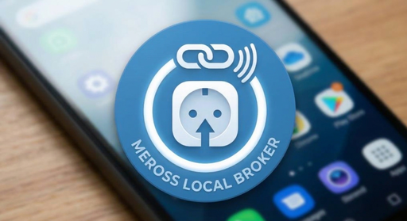

# Meross Local Broker — add-on Home Assistant



Add-on **non officiel** qui remplace le cloud Meross par un broker local pour
Home Assistant. Il permet de contrôler les appareils Meross sur le réseau local,
sans dépendre du cloud pour l'usage quotidien.


## Les trois briques du montage

| Brique                  | Rôle                              | Dépôt                                                                           |
| ----------------------- | --------------------------------- | ------------------------------------------------------------------------------- |
| **Meross Local Broker** | add-on : broker MQTT + API locale | [mazkagaz/meross-local-broker](https://github.com/mazkagaz/meross-local-broker) |
| **Meross Local Cloud**  | intégration Home Assistant (HACS) | [mazkagaz/meross-cloud](https://github.com/mazkagaz/meross-cloud)               |
| **Meross Local Pairer** | application Android d'appairage   | [mazkagaz/meross-local-pairer](https://github.com/mazkagaz/meross-local-pairer) |

```
MRS100 ──MQTT/TLS──> add-on Meross Local Broker ──API/MQTT──> intégration HA
                            ^
                            │ appairage initial
                       Meross Local Pairer (Android)
```

## Avant de commencer

- Home Assistant OS ou Supervised (l'add-on a besoin du Supervisor).
- HACS installé, pour l'intégration Home Assistant.
- Un MRS100 et un Wi-Fi **2,4 GHz en WPA2**.
- Un téléphone Android pour Meross Local Pairer.
- Installations **amd64** ou **aarch64** uniquement (les architectures 32 bits
  ne sont plus construites).

## Installation complète

### 1. Installer l'add-on

Dans Home Assistant :

1. **Paramètres → Modules complémentaires → Boutique de modules**.
2. Menu **⋮ → Dépôts**.
3. Ajouter `https://github.com/mazkagaz/meross-local-broker`.
4. Installer **Meross Local Broker**, puis démarrer.

Le bouton ci-dessous ouvre directement la boîte de dialogue :

[](https://my.home-assistant.io/redirect/supervisor_add_addon_repository/?repository_url=https%3A%2F%2Fgithub.com%2Fmazkagaz%2Fmeross-local-broker)

### 2. Créer le compte local du broker

1. Ouvrir le panneau **Local Meross Broker** de l'add-on.
2. Créer un compte local, par exemple `meross-local`, avec un mot de passe.
3. Aucun identifiant cloud Meross n’est demandé : ce compte reste local.
4. Valider. L'add-on redémarre ses services.

Ce compte sert uniquement au broker local. Ce n'est pas votre compte Meross
cloud.

En cas de besoin, la même opération peut être faite en ligne de commande
(remplacer l'adresse et le mot de passe) :

```bash
curl -s -X PUT http://homeassistant.local:2003/_admin_/configuration \
  -H 'Content-Type: application/json' \
  -d '{"email":"meross-local","password":"MotDePasseLocal"}'
```

La réponse contient `userId` et `mqttKey`. Le `userId` vaut normalement `1`.

### 3. Appairer le MRS100

Suivre la procédure de
[Meross Local Pairer](https://github.com/mazkagaz/meross-local-pairer#appairage-pas-à-pas).
L'application configure le MRS100 pour qu'il se connecte à cet add-on.

Une fois l'appairage terminé :

- l'add-on doit journaliser la connexion du MRS100 et son passage **ONLINE** ;
- `curl http://homeassistant.local:2003/_admin_/devices` doit afficher l'appareil.

### 4. Installer l'intégration Home Assistant

Suivre la procédure de
[Meross Local Cloud](https://github.com/mazkagaz/meross-cloud#installation-avec-hacs).
L'intégration s'installe avec **HACS**, puis se configure avec le compte local
du broker.

Champs usuels :

| Champ                            | Valeur                                      |
| -------------------------------- | ------------------------------------------- |
| HTTP API Endpoint                | `http://homeassistant.local:2003`           |
| MQTT Address                     | `homeassistant.local:2001`                  |
| Local login                      | le compte local, par exemple `meross-local` |
| Password                         | le mot de passe local                       |
| Skip MQTT certificate validation | coché                                       |

Si `homeassistant.local` ne répond pas, utiliser l'adresse IP de Home Assistant.

### 5. Vérifier

Dans Home Assistant, l'appareil doit apparaître avec :

- une entité `cover` pour le volet ;
- deux entités `number` pour les durées d'ouverture/fermeture ;
- deux boutons de calibration ;
- un capteur **Calibration status**.

## Utilisation

- **Ouvrir/fermer** : entité `cover`.
- **Durées** : entités `number` (10 à 120 secondes). Les valeurs sont
  persistées par l'add-on et réappliquées après reconnexion.
- **Calibration** : bouton **Start calibration**, puis suivi dans
  **Calibration status** (`in_progress`, `success`, `timeout`,
  `motor_blocked`, `failed_N`). **Stop calibration** interrompt le mouvement.

## Réglage `device_timezone`

L'option `device_timezone` pousse le fuseau et les règles d'heure d'été aux
appareils. Laisser vide pour utiliser le fuseau de Home Assistant.

## Dépannage

| Problème                            | Vérifier                                                                 |
| ----------------------------------- | ------------------------------------------------------------------------ |
| L'add-on ne démarre pas             | architecture amd64/aarch64, logs du Supervisor, image GHCR publique      |
| Aucun appareil dans l'add-on        | appairage Meross Local Pairer, port MQTT 2001, Wi-Fi 2,4 GHz WPA2        |
| L'intégration ne voit pas le broker | mode LAN-only, adresse HTTP 2003, certificat MQTT ignoré                 |
| Entités absentes                    | appareil ONLINE dans l'add-on, puis redémarrer l'intégration             |
| Durées non conservées               | logs `Stored roller-shutter config` / `Re-applied roller-shutter config` |
| Appareil déjà lié au cloud Meross   | réinitialiser l'appareil avant l'appairage local                         |

## Documentation technique

- [MRS100.md](MRS100.md) — détails du support MRS100.
- [TESTING.md](TESTING.md) — tests unitaires et checklist matérielle.
- [BUILDING.md](BUILDING.md) — construction de l'image et publication.

## Origine et licence

Fork non officiel de
[albertogeniola/ha-meross-local-broker](https://github.com/albertogeniola/ha-meross-local-broker),
sous **Apache License 2.0**. Le texte de licence et l'attribution upstream sont
conservés dans `LICENSE`, `NOTICE`, `MODIFICATIONS.md` et `LEGAL.md`.

Ce fork n'est ni affilié, ni approuvé, ni sponsorisé par Meross ou l'auteur
upstream. Meross est une marque de son propriétaire respectif.
