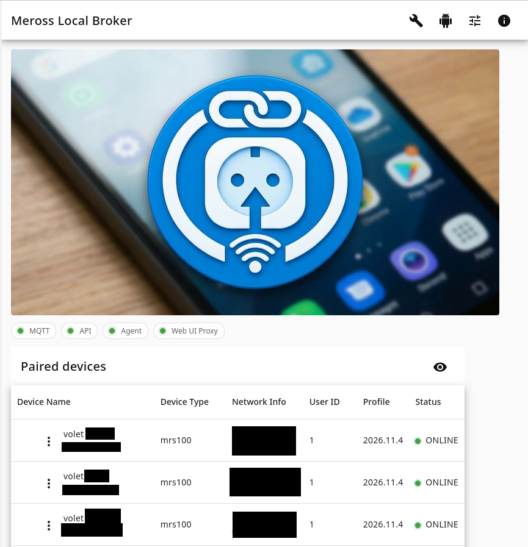
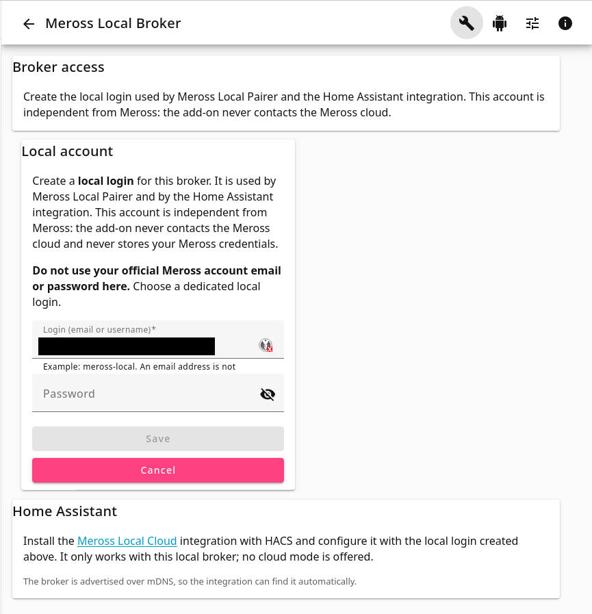
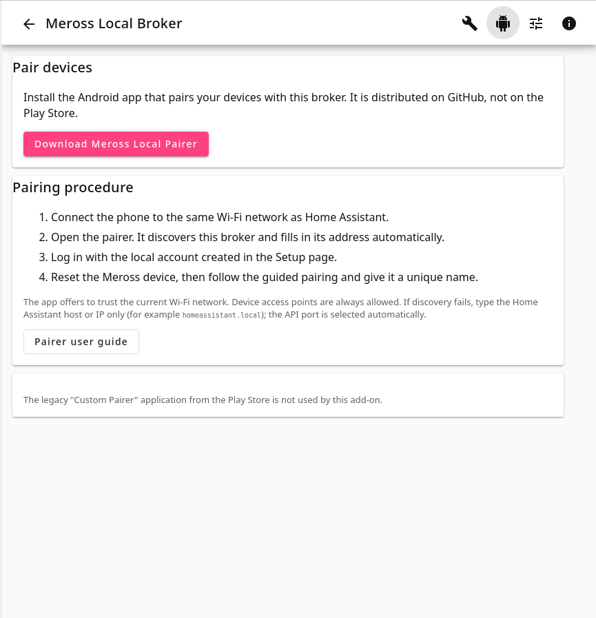
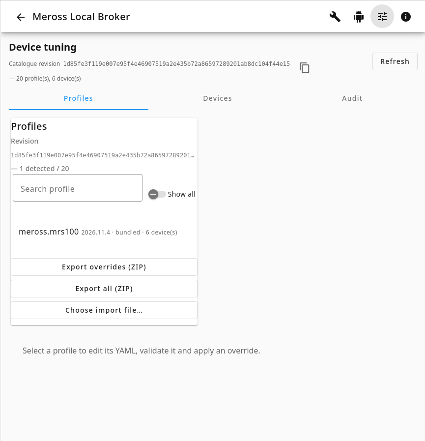

# Interface web du broker

Cette page présente les écrans principaux de l’administration du broker.

L’administration est accessible depuis le panneau **Meross Local Broker** de
Home Assistant, via l’ingress du Supervisor. Elle n’est pas destinée à être
exposée directement sur le réseau.

Les captures sont indicatives : les noms, adresses et appareils affichés sont
des exemples.

## Accueil

_Vue d’ensemble : état des services, appareils appairés et profil appliqué._

## Configuration

_Création du compte local et accès à l’intégration Home Assistant._

## Lien vers l’application d’appairage

_Téléchargement du pairer Android et procédure d’appairage._

## Tuning des appareils

_Page de tuning, onglet Profils : catalogue, recherche et import/export._

Pour le détail des actions disponibles, voir
[le guide de tuning](DEVICE-TUNING.fr.md).
