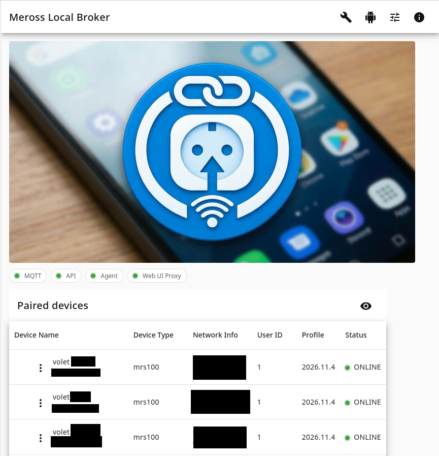
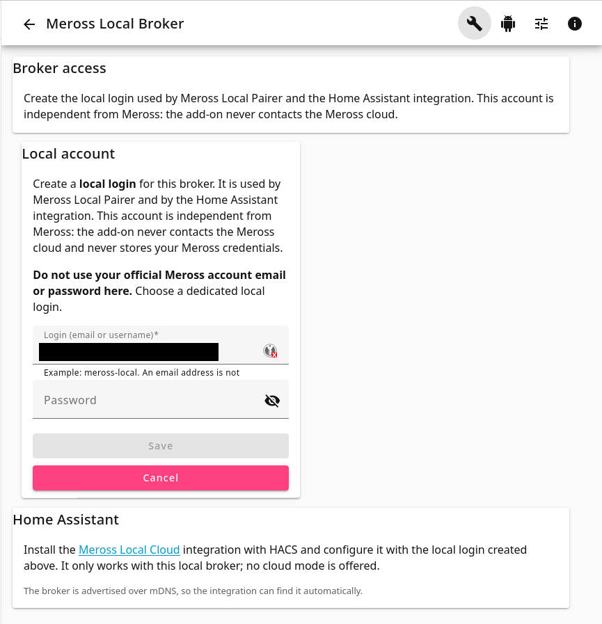
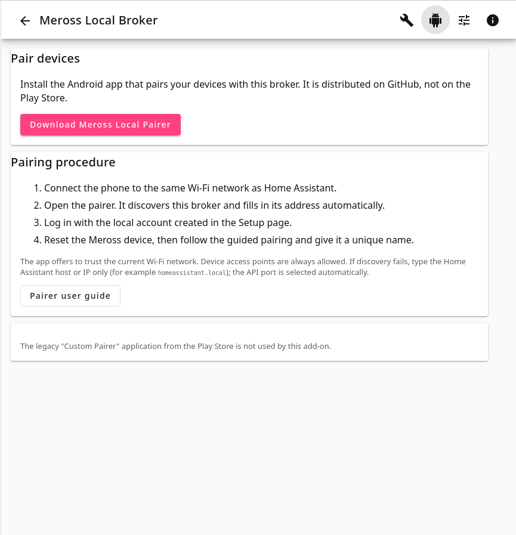
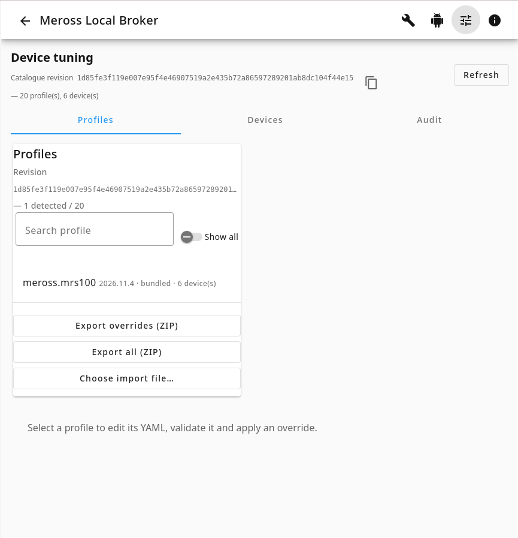

# Broker web interface

This page shows the main screens of the broker administration interface.

The administration page is available from the **Meross Local Broker** panel in
Home Assistant, through Supervisor ingress. It is not intended to be exposed
directly to the network.

The screenshots are illustrative: names, addresses and devices shown are
examples.

## Home

_Overview: service status, paired devices and applied profile._

## Configuration

_Creating the local account and accessing the Home Assistant integration._

## Pairing app link

_Downloading the Android pairer and the pairing procedure._

## Device tuning

_Tuning page, Profiles tab: catalog, search and import/export._

For details about the available actions, see the
[tuning guide](DEVICE-TUNING.md).
